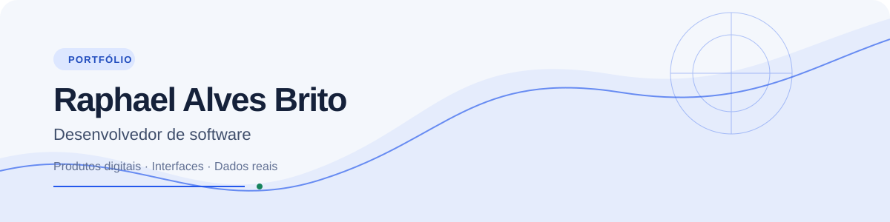
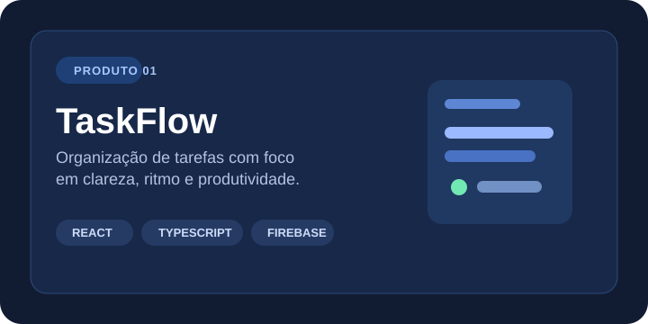
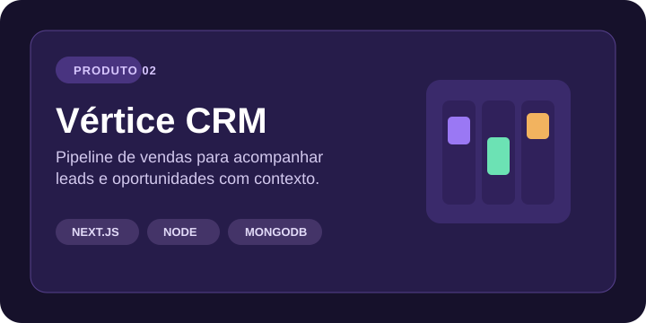
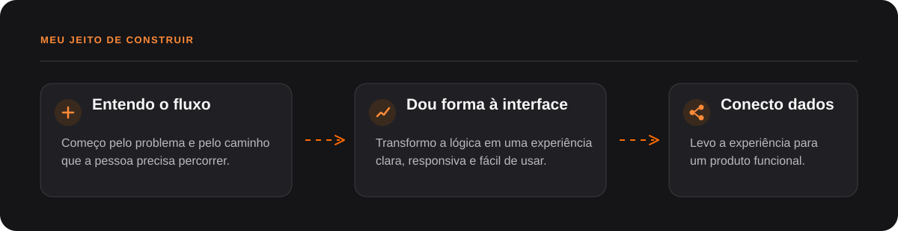

<picture>
  <source media="(prefers-color-scheme: dark)" srcset="./assets/hero-dark.svg">
  
</picture>

 

### Olá, eu sou o Raphael

Desenvolvedor de software em formação, construindo aplicações web que transformam fluxos do dia a dia em produtos claros, úteis e funcionais.

Meu foco está em unir **interface bem pensada**, **código organizado** e **dados persistentes**. Em vez de projetos apenas demonstrativos, desenvolvo experiências completas — do problema à entrega.

<strong>TECNOLOGIAS QUE USO</strong> 

 <strong>APROFUNDANDO AGORA</strong> 
 
Vue.js · Firebase/Firestore · MongoDB · arquitetura front-end · gerenciamento de estado · otimização web

 <strong>PRÓXIMOS ESTUDOS</strong> 

 

### Produtos que já têm forma

 

### Como eu transformo ideia em produto

  <a href="https://github.com/Britou?tab=repositories">Explorar projetos</a>

### Vamos conversar?

  
  &nbsp;&nbsp;
  
  &nbsp;&nbsp;
  

